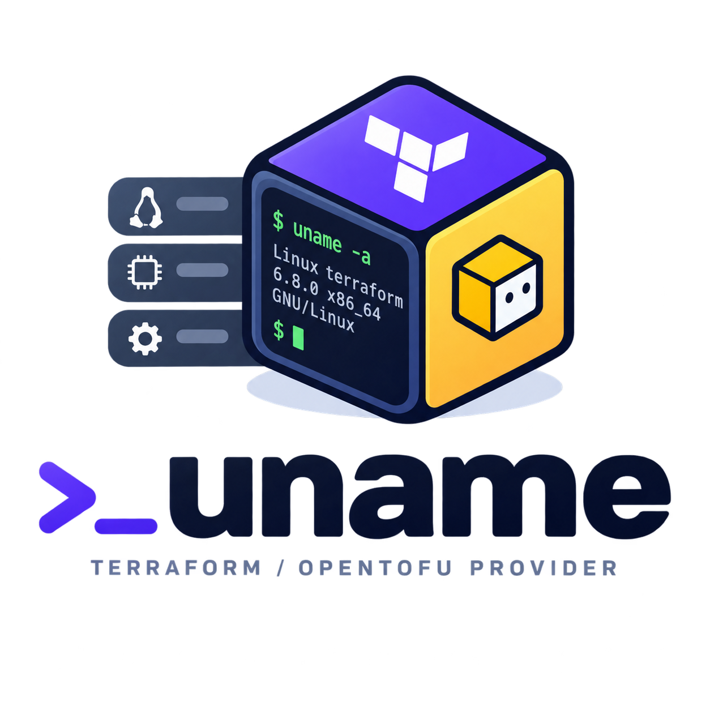

# Terraform Provider for uname



The Uname Provider is a plugin for Terraform & OpenTofu that allows to access system information from a Data Source.

Terraform Registry URL: [https://registry.terraform.io/providers/julienlevasseur/uname](https://registry.terraform.io/providers/julienlevasseur/uname)

OpenTofu Regtistry URL: [https://search.opentofu.org/provider/julienlevasseur/uname/latest](https://search.opentofu.org/provider/julienlevasseur/uname/latest)

## Quick Starts

- [Using the provider](https://github.com/julienlevasseur/terraform-provider-uname/blob/main/docs/index.md)

## Testing

### Acceptance

```bash
make testacc
```

### Integration

To test the provider locally, you will need a `~/.terraformrc` file:
```
provider_installation {
    dev_overrides {
        "registry.terraform.io/julienlevasseur/uname" = "${PATH_TO_THE_MODULE}"
    }

    direct {}
}
```

And to compile the provider (from the root folder of the module):
```bash
go build .
```

You can then validate the provider's behavior with a test module:
```hcl
terraform {
  required_providers {
    uname = {
      source  = "julienlevasseur/uname"
    }
  }
}

provider "uname" {}

data "uname" "localhost" {}

output "function_uname" {
  value = provider::uname::uname()
}

output "uname" {
  value = data.uname.localhost.kernel_name
}
```
